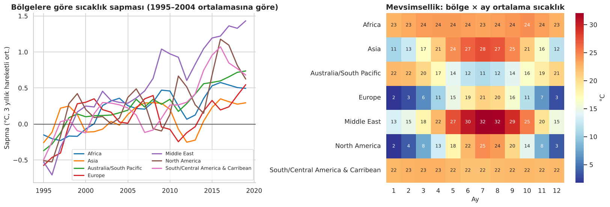
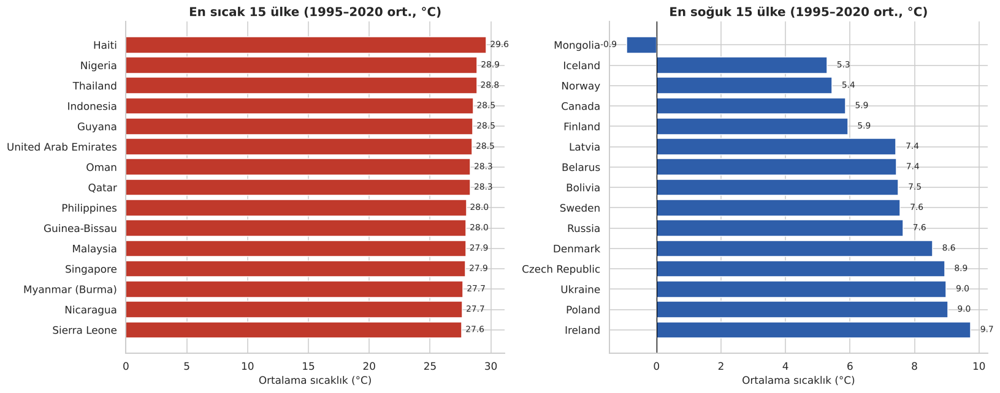

# 🌍 Küresel Sıcaklık Analizi ve Tahmini

<p align="center">
  
  
  
  
  
</p>

<p align="center">
  <a href="https://nbviewer.org/github/Memreu/Global-Temperature-Prediction-Project/blob/main/GlobalTemperaturePredictionProject.ipynb"></a>
  <a href="https://www.kaggle.com/code/memreu/globaltemperaturepredictionproject"></a>
</p>

125 ülkedeki 321 şehirden 1995–2020 arasında toplanmış **2,8 milyon günlük sıcaklık ölçümünü** inceleyen ve ülke + yıl + ay bilgisinden günlük ortalama sıcaklığı tahmin eden bir makine öğrenmesi projesi. *Global AI Hub × Akbank Makine Öğrenmesine Giriş Bootcamp'i* kapsamında geliştirildi.

<p align="center"></p>

> 🇬🇧 **In English:** An exploratory and predictive analysis of 2.8M daily temperature records from 321 cities in 125 countries (1995–2020). After cleaning missing-value placeholders, a grid-searched Random Forest predicts daily average temperature from country, year and month with **R² = 0.73** and **MAE ≈ 4 °C**. A follow-up check shows that country × month averages alone explain 73% of the variance, i.e. the model mainly learns each country's seasonal climate normal. The data also shows warming in every region, strongest in the Middle East (+1.3 °C in 2015–19 vs. 1995–2004).

<details>
<summary><b>📑 İçindekiler</b></summary>

- [Öne çıkan sonuçlar](#öne-çıkan-sonuçlar)
- [Temel bulgular](#temel-bulgular)
- [Model](#model)
- [Proje akışı](#proje-akışı)
- [Kurulum ve çalıştırma](#kurulum-ve-çalıştırma)
- [Klasör yapısı](#klasör-yapısı)
- [Veri](#veri)
- [Sınırlılıklar ve sonraki adımlar](#sınırlılıklar-ve-sonraki-adımlar)

</details>

## Öne çıkan sonuçlar

| | Sonuç |
|---|---|
| 🧹 **Veri temizliği** | Eksik ölçümü ifade eden 79.672 adet `-99` değeri çıkarıldı; 2.826.655 ölçüm kaldı |
| 🌲 **Model** | Izgara aramayla ayarlanmış Random Forest (200 ağaç, derinlik 20) |
| 🎯 **Performans** | **R² 0,73** · MAE 7,13 °F (**≈ 4,0 °C**) · RMSE 9,86 °F (≈ 5,5 °C) |
| 🔍 **Ne öğreniyor?** | Ülke × ay ortalaması tek başına varyansın **%73**'ünü açıklıyor: model esasen her ülkenin mevsimsel iklim normalini öğreniyor |
| 🌡️ **Isınma** | 2015–19 döneminde her bölge 1995–2004 ortalamasından daha sıcak; en büyük artış Orta Doğu'da (**+1,3 °C**) |

## Temel bulgular

1. **Sıcaklığın büyük kısmı coğrafya ve mevsimle açıklanıyor.** Aynı ülkenin aynı ayındaki günler birbirine çok benziyor. Bu yüzden yalnızca ülke, yıl ve ay bilgisiyle R² 0,73'e ulaşmak mümkün; kalan varyans günlük hava değişkenliğinden geliyor.
2. **Isınma tüm bölgelerde görülüyor ama hızı farklı.** 2015–19 ortalaması 1995–2004'e göre Orta Doğu'da +1,3 °C, Kuzey Amerika'da +1,0 °C, Güney/Orta Amerika'da +0,9 °C, Asya ve Avrupa'da ise +0,3 °C daha yüksek.
3. **Mevsimsellik bölgeye göre çok farklı.** Kış ile yaz arasındaki fark Avrupa'da ~19 °C, Kuzey Amerika'da ~23 °C iken, Afrika ve Güney/Orta Amerika'da yıl boyunca sıcaklık neredeyse sabit; Avustralya'da ise mevsimler ters.
4. **En sıcak ve en soğuk ülkeler.** Ortalamada Haiti (29,6 °C), Nijerya ve Tayland en sıcak; Moğolistan (−0,9 °C), İzlanda ve Norveç en soğuk ülkeler.

<p align="center"></p>

## Model

| Ayar | Değer |
|---|---|
| Özellikler | `Year`, `Month`, `CountryEncoded` (LabelEncoder) |
| Hedef | Günlük ortalama sıcaklık (°F) |
| Bölme | %80 eğitim / %20 test (rastgele) |
| Algoritma | `RandomForestRegressor` |
| Hiperparametre araması | `GridSearchCV` (3 katlı CV): `n_estimators` ∈ {100, 200}, `max_depth` ∈ {10, 20}, `min_samples_split` ∈ {2, 5} |
| En iyi parametreler | `n_estimators=200`, `max_depth=20`, `min_samples_split=5` |

## Proje akışı

| # | Bölüm | Teknik |
|---|---|---|
| 1 | Veri yükleme | 2,9 milyon satırlık günlük şehir verisi |
| 2 | Keşifçi analiz | Eksik değerler, dağılımlar, ülke bazlı ortalamalar |
| 3 | Veri temizliği | `-99` yer tutucularının çıkarılması, °F → °C dönüşümü |
| 4 | Özellik mühendisliği | Ülke kodlama (LabelEncoder) |
| 5 | Modelleme | Random Forest + GridSearchCV |
| 6 | Değerlendirme | MAE, MSE, R² ve yorumlar |

## Kurulum ve çalıştırma

```bash
git clone https://github.com/Memreu/Global-Temperature-Prediction-Project.git
cd Global-Temperature-Prediction-Project
pip install -r requirements.txt
unzip "Veri Seti.zip"          # GlobalLandTemperaturesByCountry.csv (~140 MB) çıkar
jupyter lab GlobalTemperaturePredictionProject.ipynb
```

README'deki grafikleri yeniden üretmek için (önce zip'i açmış olmalısın):

```bash
python scripts/readme_grafikleri.py
```

**Kurulum yapmadan incelemek için:**
- 📓 [nbviewer'da görüntüle](https://nbviewer.org/github/Memreu/Global-Temperature-Prediction-Project/blob/main/GlobalTemperaturePredictionProject.ipynb)
- 🏅 Kaggle notebook'ları: [memreu](https://www.kaggle.com/code/memreu/globaltemperaturepredictionproject) · [kerembey](https://www.kaggle.com/code/kerembey/globaltemperaturepredictionproject)

## Klasör yapısı

```
├── GlobalTemperaturePredictionProject.ipynb   # Ana notebook (çıktılarıyla birlikte)
├── Veri Seti.zip                              # Ham veri (GlobalLandTemperaturesByCountry.csv)
├── scripts/
│   └── readme_grafikleri.py                   # README grafiklerini üreten betik
├── images/                                    # README grafikleri
├── requirements.txt
├── LICENSE
└── README.md
```

## Veri

[Temperature of All Countries (1995–2020)](https://www.kaggle.com/datasets/subhamjain/temperature-of-all-countries-19952020) (Kaggle): Dünya genelinde 321 şehrin günlük ortalama sıcaklıkları (°F). Değişkenler: `Region`, `Country`, `State`, `City`, `Month`, `Day`, `Year`, `AvgTemperature`. Eksik ölçümler `-99` ile kodlanmıştır.

## Sınırlılıklar ve sonraki adımlar

- **Bu bir gelecek tahmini değil, bir enterpolasyon.** Eğitim ve test verisi rastgele ayrıldığı için model, test günlerinin hemen öncesini ve sonrasını eğitimde görmüş oluyor. Gerçek bir "gelecek" testi için örneğin 1995–2016 ile eğitip 2017–2020 üzerinde değerlendirmek gerekir.
- **Güçlü bir temel modelle karşılaştırılmalı.** "Ülkenin o aydaki geçmiş ortalaması" gibi basit bir tahmin zaten R² ≈ 0,73 veriyor; modelin değeri bu temel modeli ne kadar geçtiğiyle ölçülmeli.
- **Zaman serisi yaklaşımı.** Gecikmeli (lag) sıcaklıklar, hareketli ortalamalar ve enlem/boylam gibi coğrafi özelliklerle; ya da Prophet, SARIMA veya LSTM gibi zaman serisi modelleriyle günlük değişkenlik de yakalanabilir.
- **Arayüz.** Modeli Streamlit veya Gradio ile basit bir web uygulamasına dönüştürmek planlanan adımlardan biri.

---

Bu proje [MIT lisansı](LICENSE) ile paylaşılmaktadır.

**Mehmet Emre Ünlü** · [GitHub](https://github.com/Memreu) · [LinkedIn](https://www.linkedin.com/in/memreu) · [Kaggle](https://www.kaggle.com/memreu)
