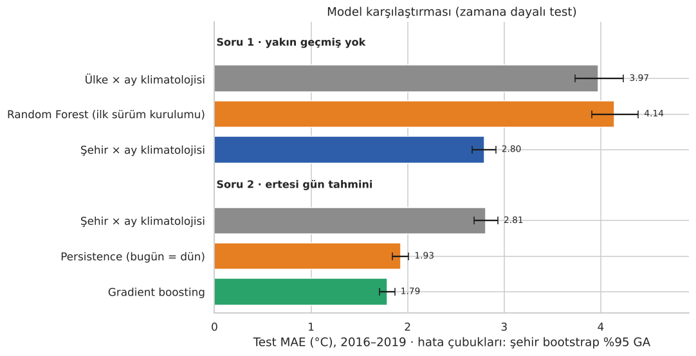
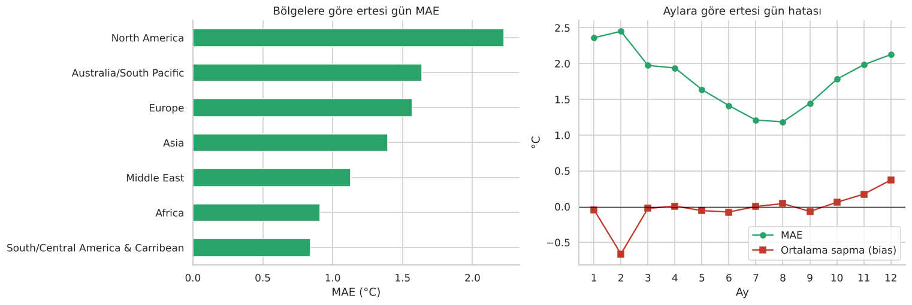

# 🌍 Küresel Sıcaklık Analizi ve Tahmini

<p align="center">
  
  
  
  
  
</p>

<p align="center">
  <a href="https://nbviewer.org/github/Memreu/Global-Temperature-Prediction-Project/blob/main/GlobalTemperaturePredictionProject.ipynb"></a>
  <a href="https://www.kaggle.com/code/memreu/globaltemperaturepredictionproject"></a>
</p>

125 ülkedeki 321 şehirden 1995–2020 arasında toplanmış **2,8 milyon günlük sıcaklık ölçümünü** inceleyen ve günlük ortalama sıcaklığı **zamana dayalı bir test düzeniyle** tahmin eden bir makine öğrenmesi projesi. *Global AI Hub × Akbank Makine Öğrenmesine Giriş Bootcamp'i* kapsamında geliştirildi.

<p align="center"></p>

> 🇬🇧 **In English:** An analysis of 2.8M daily temperature records from 125 countries (1995–2019). The first version reported R² = 0.73 for a Random Forest on country, year and month, but with a random train/test split. Re-evaluated on a time-based split (train 1995–2015, test 2016–2019), that model is slightly *worse* than simply using each country's monthly mean (MAE 4.14 vs 3.97 °C). City-level climatology brings MAE to 2.80 °C, and a next-day gradient-boosting forecast using the last few days' observations reaches **MAE 1.79 °C**, beating the "tomorrow = today" baseline by 7% (paired city-bootstrap 95% CI for the difference: −0.15 to −0.13 °C). The data also shows warming in every region, strongest in the Middle East (+1.3 °C in 2015–19 vs. 1995–2004).

<details>
<summary><b>📑 İçindekiler</b></summary>

- [Öne çıkan sonuçlar](#öne-çıkan-sonuçlar)
- [Temel bulgular](#temel-bulgular)
- [Model](#model)
- [Proje akışı](#proje-akışı)
- [Kurulum ve çalıştırma](#kurulum-ve-çalıştırma)
- [Klasör yapısı](#klasör-yapısı)
- [Veri](#veri)
- [Sınırlılıklar ve sonraki adımlar](#sınırlılıklar-ve-sonraki-adımlar)

</details>

## Öne çıkan sonuçlar

Test dönemi 2016–2019, eğitim 1995–2015. Köşeli parantezler şehir düzeyinde bootstrap ile %95 güven aralığı.

| Soru | Model | Test MAE (°C) |
|---|---|---|
| Yakın geçmiş yok (ülke, yıl, ay) | Ülke × ay klimatolojisi | 3,97 [3,73; 4,24] |
| | Random Forest (ilk sürüm kurulumu) | 4,14 [3,91; 4,39] |
| | Şehir × ay klimatolojisi | 2,80 [2,67; 2,91] |
| Ertesi gün tahmini | "Bugün = dün" (persistence) | 1,92 [1,84; 2,01] |
| | **Gradient boosting** | **1,79 [1,71; 1,87]** |

<p align="center"></p>

### İlk sürümden bu yana neler değişti?

İlk sürüm rastgele bölmeyle **R² 0,73** raporluyordu. Rastgele bölmede model test günlerinin öncesini ve sonrasını eğitimde gördüğü için bu bir enterpolasyondu. Bu sürümde:

- Eğitim ve test **zamana göre** ayrıldı; test seti yalnızca en sonda bir kez açıldı.
- Modeller **klimatoloji** ve **persistence** temel modelleriyle kıyaslandı.
- Analiz baştan sona **°C** ile yapıldı (ilk sürümde hedef °F, grafik eksenleri °C idi).
- Hata metrikleri **şehir düzeyinde bootstrap** güven aralıklarıyla verildi; aynı şehrin günleri bağımsız olmadığı için satır düzeyinde bootstrap aralıkları yapay olarak daraltırdı.
- Veri temizliğine hatalı yıllar (200, 201), `Day = 0` satırları ve tekrarlanan şehir-gün kayıtları eklendi.
- Notebook hücre sırası düzeltildi; baştan sona çalışıyor.

## Temel bulgular

1. **Sıcaklığın büyük kısmı coğrafya ve mevsimle açıklanıyor.** Aynı ülkenin aynı ayındaki günler birbirine çok benziyor. Ülke × ay ortalaması varyansın %73'ünü, şehir × ay ortalaması %87'sini açıklıyor; kalan kısım günlük hava değişkenliği.
2. **Isınma tüm bölgelerde görülüyor ama hızı farklı.** 2015–19 ortalaması 1995–2004'e göre Orta Doğu'da +1,3 °C, Kuzey Amerika'da +1,0 °C, Güney/Orta Amerika'da +0,9 °C, Asya ve Avrupa'da ise +0,3 °C daha yüksek.
3. **Mevsimsellik bölgeye göre çok farklı.** Kış ile yaz arasındaki fark Avrupa'da ~19 °C, Kuzey Amerika'da ~23 °C iken, Afrika ve Güney/Orta Amerika'da yıl boyunca sıcaklık neredeyse sabit; Avustralya'da ise mevsimler ters.
4. **En sıcak ve en soğuk ülkeler.** Ortalamada Haiti (29,6 °C), Nijerya ve Tayland en sıcak; Moğolistan (−0,9 °C), İzlanda ve Norveç en soğuk ülkeler.

<p align="center"></p>

## Model

| Ayar | Değer |
|---|---|
| Bölme | Eğitim 1995–2015 · test 2016–2019 (2020 yalnızca Ocak–Mayıs olduğu için dışarıda) |
| Hedef | Günlük ortalama sıcaklık (°C) |
| Soru 1 özellikleri | `Year`, `Month`, ülke kodu (ilk sürümün kurulumu) |
| Soru 2 özellikleri | Son 3 günün sıcaklığı, son 7 günün ortalaması, şehir ve ülke klimatolojisi, dünkü anomali, yılın günü (sin/cos), yıl, bölge |
| Algoritma | `HistGradientBoostingRegressor` (Soru 2), `RandomForestRegressor` (Soru 1, ilk sürümün hiperparametreleriyle) |
| Hiperparametre seçimi | Eğitim yılları içinde doğrulama: 1995–2011 eğitim, 2012–2015 doğrulama |
| Sızıntı önlemleri | Klimatoloji yalnızca eğitim yıllarından; gecikmeli değerler yalnızca gerçekten önceki takvim gününe aitse |
| Belirsizlik | Şehir düzeyinde bootstrap (1.000 tekrar), modeller arası eşleştirilmiş fark |

<p align="center"></p>

Ertesi gün hatası kışın en yüksek; Kuzey Amerika, kıtasal iklimdeki büyük günlük dalgalanmalar nedeniyle en zor bölge.

## Proje akışı

| # | Bölüm | Teknik |
|---|---|---|
| 1 | Veri | Zip dosyasından doğrudan okuma |
| 2 | Veri kalitesi | `-99`, hatalı yıllar, `Day = 0`, tekrarlanan kayıtlar; °F → °C |
| 3 | Keşifçi analiz | Ülke ortalamaları, coğrafya ve mevsimin açıkladığı varyans |
| 4 | Zamana dayalı bölme | Sızıntısız klimatoloji ve gecikmeli özellikler |
| 5 | Değerlendirme | MAE, RMSE, R², şehir bootstrap güven aralıkları |
| 6 | Soru 1 | Klimatoloji temel modelleri ve ilk sürümün Random Forest'ı |
| 7 | Soru 2 | Persistence ve gradient boosting; eğitim içi doğrulamayla hiperparametre seçimi |
| 8 | Hata analizi | Bölge ve ay bazında hata ve sapma |

## Kurulum ve çalıştırma

```bash
git clone https://github.com/Memreu/Global-Temperature-Prediction-Project.git
cd Global-Temperature-Prediction-Project
pip install -r requirements.txt
jupyter lab GlobalTemperaturePredictionProject.ipynb   # zip dosyasını doğrudan okur, ~3 dakikada çalışır
```

İlk iki keşifçi analiz grafiğini yeniden üretmek için (önce `unzip "Veri Seti.zip"`):

```bash
python scripts/readme_grafikleri.py
```

**Kurulum yapmadan incelemek için:**
- 📓 [nbviewer'da görüntüle](https://nbviewer.org/github/Memreu/Global-Temperature-Prediction-Project/blob/main/GlobalTemperaturePredictionProject.ipynb)
- 🏅 Kaggle notebook'ları: [memreu](https://www.kaggle.com/code/memreu/globaltemperaturepredictionproject) · [kerembey](https://www.kaggle.com/code/kerembey/globaltemperaturepredictionproject)

## Klasör yapısı

```
├── GlobalTemperaturePredictionProject.ipynb   # Ana notebook (çıktılarıyla birlikte)
├── Veri Seti.zip                              # Ham veri (GlobalLandTemperaturesByCountry.csv)
├── scripts/
│   └── readme_grafikleri.py                   # README grafiklerini üreten betik
├── images/                                    # README grafikleri (03 ve 04 notebook'ta üretilir)
├── requirements.txt
├── LICENSE
└── README.md
```

## Veri

[Temperature of All Countries (1995–2020)](https://www.kaggle.com/datasets/subhamjain/temperature-of-all-countries-19952020) (Kaggle): Dünya genelinde 321 şehrin günlük ortalama sıcaklıkları (°F). Değişkenler: `Region`, `Country`, `State`, `City`, `Month`, `Day`, `Year`, `AvgTemperature`. Eksik ölçümler `-99` ile kodlanmıştır.

## Sınırlılıklar ve sonraki adımlar

- **Tek değişken.** Veride yalnızca ortalama sıcaklık var; yağış, nem, rüzgâr ve basınç gibi değişkenler ertesi gün tahminini belirgin biçimde iyileştirebilir.
- **Örneklem dengesi.** Şehirlerin önemli kısmı ABD'de; bölge sonuçları bu dengesizliği yansıtıyor.
- **Klimatoloji kayması.** Klimatoloji 1995–2015 ortalaması; ısınma nedeniyle test döneminde biraz soğuk tarafta kalabilir. Modeldeki yıl değişkeni bunu kısmen telafi ediyor.
- **Zaman serisi modelleri.** Şehir bazında SARIMA veya durum uzayı modelleri gradient boosting ile aynı test düzeninde kıyaslanabilir.

---

Bu proje [MIT lisansı](LICENSE) ile paylaşılmaktadır.

**Mehmet Emre Ünlü** · [GitHub](https://github.com/Memreu) · [LinkedIn](https://www.linkedin.com/in/memreu) · [Kaggle](https://www.kaggle.com/memreu)
